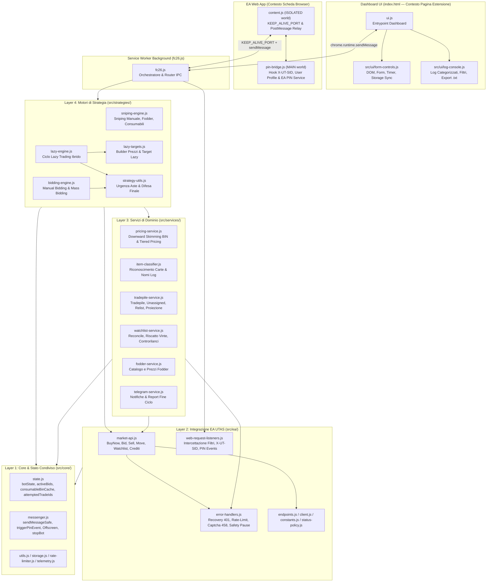
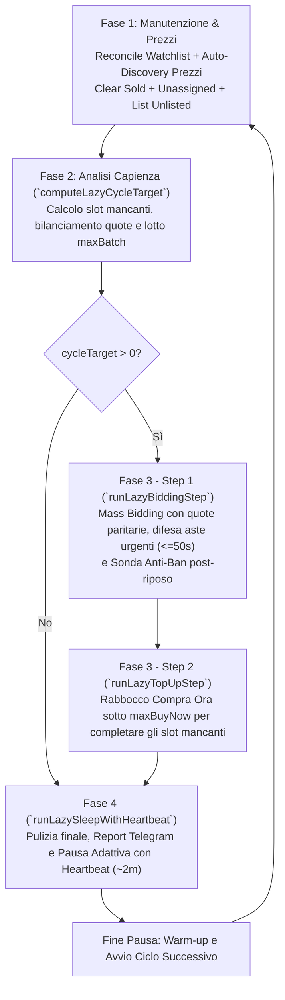

# FC Sniper & Trader - Documentazione Ufficiale & Guida Architetturale

Estensione browser (**Chrome Manifest V3**, ES6 Modules) per l'automazione avanzata del trading sulla Web App di **EA SPORTS FC (FC27)**. Integra algoritmi di **Sniping Diretto**, **Mass Bidding** e **Lazy Trading Ibrido**, supportati da un bridge di telemetria PIN nativo per massimizzare la sicurezza dell'account contro i controlli anti-cheat di EA.

---

## Indice
1. [Architettura del Sistema](#1-architettura-del-sistema)
   - [Diagramma dei Layer e delle Dipendenze](#diagramma-dei-layer-e-delle-dipendenze)
   - [Mappa Completa dei Moduli](#mappa-completa-dei-moduli)
2. [Guida per Sviluppatori e Agenti AI: Convenzioni e Contratti](#2-guida-per-sviluppatori-e-agenti-ai-convenzioni-e-contratti)
   - [2.1 Regole sulle Dipendenze (DAG Unidirezionale)](#21-regole-sulle-dipendenze-dag-unidirezionale)
   - [2.2 Gestione dello Stato Condiviso (`botState`)](#22-gestione-dello-stato-condiviso-botstate)
   - [2.3 Protocollo di Messaggistica IPC (`chrome.runtime` & `window.postMessage`)](#23-protocollo-di-messaggistica-ipc-chromeruntime--windowpostmessage)
   - [2.4 Schema Chiavi `chrome.storage.local`](#24-schema-chiavi-chromestoragelocal)
   - [2.5 Convenzioni dei Log e Classificatore UI (`classifyLogMessage`)](#25-convenzioni-dei-log-e-classificatore-ui-classifylogmessage)
   - [2.6 Invarianti Anti-Ban (Regole Critiche da Non Violare)](#26-invarianti-anti-ban-regole-critiche-da-non-violare)
   - [2.7 Checklist: Come Aggiungere un Nuovo Target o Strategia](#27-checklist-come-aggiungere-un-nuovo-target-o-strategia)
3. [Strategie di Trading](#3-strategie-di-trading)
   - [1. Sniping Diretto (BIN)](#1-sniping-diretto-bin--risoluzione-errore-461)
   - [2. Mass Bidding & Manual Bidding (Aste)](#2-mass-bidding--manual-bidding-aste)
   - [3. Lazy Trading (Fodder, Consumabili, Campionati, Allenatori)](#3-lazy-trading-fodder-consumabili-campionati-allenatori)
4. [Funzionamento Dettagliato del Lazy Trading](#4-funzionamento-dettagliato-del-lazy-trading)
   - [Il Ciclo Operativo Ibrido Protetto](#il-ciclo-operativo-ibrido-protetto-mass-bidding--rabbocco-compra-ora-al-floor-bin)
   - [Perché la Pausa di 63 Minuti](#perché-la-pausa-di-63-minuti)
   - [Controllo Dinamico del Lowest BIN & Downward Skimming](#controllo-dinamico-del-lowest-bin--downward-skimming)
   - [Vendita Scaglionata a 3 Tier (+6%, +10%, +15%) e Scalini EA](#vendita-scaglionata-a-3-tier-6-10-15-e-scalini-ea)
   - [Sistema Keep-Alive Port (Manifest V3) & Heartbeat Anti-Scadenza EA](#sistema-keep-alive-port-manifest-v3--heartbeat-anti-scadenza-ea)
   - [Spegnimento Notturno e Ripresa del Giorno Dopo](#spegnimento-notturno-e-ripresa-del-giorno-dopo)
5. [Sistemi Anti-Ban e Sicurezza](#5-sistemi-anti-ban-e-sicurezza)
6. [Configurazione da Interfaccia Utente (UI)](#6-configurazione-da-interfaccia-utente-ui)
7. [Guida all'Installazione e Verifica](#7-guida-allinstallazione-e-verifica)

---

## 1. Architettura del Sistema

Il progetto adotta un'architettura modulare **ES6 nativa** (`"type": "module"` sia nel Service Worker `fc26.js` sia nella Dashboard `ui.js`), organizzata in **4 layer di backend** sotto `src/` più un **layer UI** dedicato. Nessun bundler esterno è richiesto: il codice sorgente nella repository è direttamente eseguibile da Chrome.

### Diagramma dei Layer e delle Dipendenze



---

### Mappa Completa dei Moduli

#### File Root (Entrypoint e Contesti Isolati)
| File | Contesto | Responsabilità |
| :--- | :--- | :--- |
| [`manifest.json`](./manifest.json) | Configurazione MV3 | Permessi, host permissions UTAS/Telegram, Service Worker ES Module (`fc26.js`), Content Script (`content.js`) e `web_accessible_resources` (`pin-bridge.js`). |
| [`fc26.js`](./fc26.js) | Service Worker (Background) | Entrypoint leggero (~350 righe): installa il rate limiter globale, ripristina lo stato da storage, registra i listener `webRequest` e `runtime.onMessage`, coordina `handleStartMessage` delegando ai motori in `src/strategies/`. |
| [`ui.js`](./ui.js) | Pagina Estensione (`index.html`) | Entrypoint della Dashboard (~200 righe): inizializza `src/ui/form-controls.js` e `src/ui/log-console.js`, gestisce i pulsanti `Start`/`Stop` e riceve gli eventi dal Service Worker. |
| [`index.html`](./index.html) & [`ui.css`](./ui.css) | Pagina Estensione | Markup e stili della Dashboard (supporta tema chiaro/scuro, metriche live e terminale log interattivo). |
| [`content.js`](./content.js) | Content Script (`ISOLATED` world) | Inietta `pin-bridge.js` nella Web App EA, valida e inoltra i messaggi `PIN_BRIDGE` tra Service Worker e pagina, mantiene attiva la porta `KEEP_ALIVE_PORT` (con ping ogni 20s). |
| [`pin-bridge.js`](./pin-bridge.js) | Script Pagina (`MAIN` world) | Intercetta il token `X-UT-SID` (da `window.services`, `fetch` e `XMLHttpRequest`), estrae il profilo utente (`personaName`) e genera eventi telemetrici nativi tramite `window.services.PIN.sendData` con coda serializzata. |
| [`offscreen.js`](./offscreen.js) & [`offscreen.html`](./offscreen.html) | Offscreen Document | Riproduce un oscillatore audio con guadagno `0` (muto) per impedire a Chrome di sospendere il Service Worker quando il bot è in esecuzione. Creato on-demand all'avvio e chiuso allo stop. |
| [`telemetry-server.js`](./telemetry-server.js) | Node.js Server (Opzionale) | Server locale su `http://127.0.0.1:3000` per log runtime (`POST /event`) e fornitura lista calciatori fodder (`GET /fut/fodder?rating=XX` da `fodder-data.json`). |

#### Layer 1: `src/core/` (Fondamenta e Stato Condiviso)
| Modulo | Esportazioni Principali | Responsabilità |
| :--- | :--- | :--- |
| [`src/core/state.js`](./src/core/state.js) | `botState`, `activeBids`, `consumableBinCache`, `attemptedTradeIds`, `isTradeAttempted`, `markTradeAttempted`, `restoreInitialStateFromStorage`, `storePendingBid`, `storePendingBidsBatch`, `removeStoredPendingBid` | Unica fonte di verità (Single Source of Truth) per lo stato mutabile del Service Worker, cache anti-carte fantasma (TTL 5 min) e sincronizzazione di `pendingBids` con `chrome.storage.local`. |
| [`src/core/messenger.js`](./src/core/messenger.js) | `sendMessageSafe`, `triggerPinEvent`, `ensureOffscreenDocument`, `stopOffscreenDocument`, `stopBot` | Invio sicuro di messaggi broadcast alla UI, invio comandi al `PIN_BRIDGE` con timeout di sicurezza (500ms), ciclo di vita dell'Offscreen Document e procedura centralizzata di arresto bot. |
| [`src/core/storage.js`](./src/core/storage.js) | `getNumeroTentativi`, `getTargetMode`, `getStrategyMode`, `getFodderRating`, `getChemStyle`, `getManagerNation`, `getAutoBin`, `getManualBin`, `getMinMargin`, `getMaxSnipePrice`, `getTargetTradepileSize`, `getLazyMarkupPercent`, `getLazySleepMinutes`, `getStoredPendingBids`, `getTelegramChatId`, `getUserProfile`, `getTradepileStatus`, `getProiezioneCrediti`, `cleanExpiredPendingBids` | Lettura tipizzata con valori di fallback da `chrome.storage.local` e pulizia delle offerte pendenti scadute da oltre 24 ore. |
| [`src/core/rate-limiter.js`](./src/core/rate-limiter.js) | `installGlobalRateLimiter`, `getRateLimiterStats` | Wrappa `self.fetch` nel Service Worker intercettando tutte le chiamate verso l'host UTAS: applica un budget orario cross-endpoint (default 2400 req/h) e un inter-arrival minimo con jitter gaussiano rigenerativo. |
| [`src/core/utils.js`](./src/core/utils.js) | `sleep`, `getRandomInRange`, `getRandomGaussian`, `getEaStep`, `calculateNextBid`, `roundDownToStep`, `roundUpToStep`, `calculateTargetMargin`, `parseFodderPrice` | Funzioni matematiche e di utilità pure (nessuna dipendenza da stato o `chrome.*`). |
| [`src/core/telemetry.js`](./src/core/telemetry.js) | `reportTelemetry` | Invio fire-and-forget di eventi diagnostici a `http://127.0.0.1:3000/event`. |

#### Layer 2: `src/ea/` (Integrazione Protocollo EA UTAS)
| Modulo | Esportazioni Principali | Responsabilità |
| :--- | :--- | :--- |
| [`src/ea/endpoints.js`](./src/ea/endpoints.js) | `EA_BASE_URL`, `TRANSFERMARKET_URL`, `AUCTIONHOUSE_URL`, `ITEM_URL`, `WATCHLIST_URL`, `DELETE_SOLD_URL`, `TRADEPILE_URL`, `UNASSIGNED_URL`, `tradeBidUrl`, `watchlistDeleteUrl` | Definizione centralizzata di tutti gli URL delle API UTAS di EA SPORTS FC. |
| [`src/ea/constants.js`](./src/ea/constants.js) | `CHEM_STYLES`, `MANAGER_LEAGUES`, `TOP_MANAGER_NATIONS`, `NATION_NAMES`, `leagueTargetKey`, `managerTargetKey` | Dizionari statici ID EA $\to$ metadati (stili intesa, campionati allenatore, nazioni) e generatori di chiavi sintetiche (`league_<id>`, `manager_nat_<id>`). |
| [`src/ea/status-policy.js`](./src/ea/status-policy.js) | `EA_STATUS_POLICY`, `isRateLimitStatus`, `getStatusAction` | Mappa dei codici HTTP EA (`401`, `426`, `429`, `458`, `461`, `470`, `478`, `512`, `521`) e classificazione delle azioni di risposta. |
| [`src/ea/client.js`](./src/ea/client.js) | `buildEaHeaders`, `eaFetch` | Costruzione degli header standard autenticati (`X-UT-SID`). |
| [`src/ea/error-handlers.js`](./src/ea/error-handlers.js) | `setPostPauseMaintenance`, `handle401Error`, `doRecover401`, `handleSearchRateLimit`, `handleCaptchaDetected`, `handleSearchHttpError`, `executeSafetyPause` | Gestione centralizzata dell'errore `401` (single-flight promise con refresh a caldo via PIN bridge e fallback reload scheda Web App), arresto immediato su CAPTCHA `458` e pause di sicurezza anti-softban. |
| [`src/ea/web-request-listeners.js`](./src/ea/web-request-listeners.js) | `registerWebRequestListeners` | Listener `chrome.webRequest` per acquisire automaticamente il filtro di ricerca `searchUrl` impostato nella Web App, sincronizzare l'header `x-ut-sid` e monitorare gli invii `pinEvents`. |
| [`src/ea/market-api.js`](./src/ea/market-api.js) | `getCrediti`, `sendBuyNowRequest`, `sendBidRequest`, `moveSingleItemToTrade`, `sendToTransferList`, `sellSingleItem`, `sellFodder`, `addToWatchlist`, `deleteFromWatchlist` | Operazioni atomiche di rete verso UTAS, complete di code anti-collisione (`1.6s` tra offerte, `1.5s` tra messe in vendita), circuit-breaker su `426` (`listingRestrictedUntil`), controrilancio automatico su `470` e retry su `461` in fase di listing. |

#### Layer 3: `src/services/` (Servizi di Dominio e Business Logic)
| Modulo | Esportazioni Principali | Responsabilità |
| :--- | :--- | :--- |
| [`src/services/item-classifier.js`](./src/services/item-classifier.js) | `formatItemDisplayName`, `detectChemistryStyle`, `detectManagerLeague`, `detectManager`, `detectConsumableKey`, `targetDisplayName`, `getItemDisplayName` | Ispeziona gli oggetti `itemData` / `auctionInfo` di EA per identificare stili intesa, modificatori campionato (`amount`), allenatori (`nation`) e generare nomi leggibili per i log. |
| [`src/services/pricing-service.js`](./src/services/pricing-service.js) | `getTieredSellPrice`, `resolveConsumableFloor`, `discoverCustomLowestBin`, `discoverConsumableLowestBin`, `discoverLeagueModifierLowestBin`, `discoverManagerLowestBin`, `discoverManualItemLowestBin`, `resolveItemSellPrice` | Algoritmo universale di **Downward Skimming** per scoprire il vero Lowest BIN istantaneo (carte fresche a 58–59m), caching a 15 minuti (`consumableBinCache`), calcolo prezzi di vendita scaglionati a 3 Tier (A/B/C) e risoluzione prezzo per qualsiasi carta vinta. |
| [`src/services/fodder-service.js`](./src/services/fodder-service.js) | `fetchFodderList`, `getFodderList`, `getNextFodder`, `getFodderPriceForItem` | Recupero, normalizzazione e rotazione del catalogo calciatori Fodder per rating dal server locale (`localhost:3000/fut/fodder`). |
| [`src/services/tradepile-service.js`](./src/services/tradepile-service.js) | `getTradepileInfo`, `calculateAndPublishProiezioneCrediti`, `clearSoldItem`, `checkAndRelistExpiredItems`, `processUnassignedItems`, `listUnlistedTradepileItems` | Gestione del ciclo di vita della Tradepile e della pila Non Assegnati: incasso vendite (`DELETE /trade/sold` solo se presenti carte vendute), relist ricalcolato al prezzo live, recupero carte non listate e calcolo della proiezione crediti. |
| [`src/services/watchlist-service.js`](./src/services/watchlist-service.js) | `reconcileWatchlistOnStartup`, `resolveWatchlist`, `checkAndProcessWatchlistForLazy` | Riconciliazione all'avvio, riscatto immediato delle aste vinte (`highest` su asta chiusa $\to$ spostamento in Tradepile $\to$ vendita), rimozione aste perse e coda di controrilanci ordinata per scadenza (con "All-In Tattico" dal 6° rilancio). |
| [`src/services/telegram-service.js`](./src/services/telegram-service.js) | `sendTelegramMessage`, `sendCycleReport` | Invio notifiche HTML su Telegram a fine ciclo con nome account, carte acquistate/vendute, stato Tradepile e crediti. |

#### Layer 4: `src/strategies/` (Motori di Strategia)
| Modulo | Esportazioni Principali | Responsabilità |
| :--- | :--- | :--- |
| [`src/strategies/strategy-utils.js`](./src/strategies/strategy-utils.js) | `getUrgentAuctionTimeRemaining`, `waitForPendingWatchlistAuctions` | Calcolo del tempo residuo dell'asta attiva più urgente e loop di difesa finale a fine sessione di bidding (fino a 15 min). |
| [`src/strategies/sniping-engine.js`](./src/strategies/sniping-engine.js) | `sendResearchRequest`, `runManualSnipingLoop`, `sendFodderResearchRequest`, `sendConsumableResearchRequest` | Motori di Sniping Compra Ora per modalità Manuale, Fodder e Consumabili. |
| [`src/strategies/bidding-engine.js`](./src/strategies/bidding-engine.js) | `sendManualBiddingRequest`, `runManualBiddingLoop`, `runMassBiddingEngine` | Motori di Mass Bidding (Fodder e Consumabili) e Manual Bidding basato su `searchUrl`. |
| [`src/strategies/lazy-targets.js`](./src/strategies/lazy-targets.js) | `buildFodderLazyTargets`, `buildManagerLeagueLazyTargets`, `buildManagersLazyTargets`, `buildConsumablesLazyTargets`, `buildLazyCycleTargets` | Fase 1b del Lazy Trading: costruisce `cyclePrices` e i descrittori uniformi `targets` (con `buildUrl(micr, kind)`, `itemFilter`, `maxBid`, `maxBuyNow`, `sellPrice`) per ciascuna delle 4 modalità supportate. |
| [`src/strategies/lazy-engine.js`](./src/strategies/lazy-engine.js) | `computeLazyCycleTarget`, `runLazyBiddingStep`, `runLazyTopUpStep`, `runLazySleepWithHeartbeat`, `runLazyTradingEngine` | Orchestratore del ciclo continuo Lazy Trading: manutenzione iniziale, calcolo fabbisogno e bilanciamento quote, Step 1 (Bidding), Step 2 (Top-Up Compra Ora) e Fase 4 (Sleep adattivo con Heartbeat). |

#### Layer UI: `src/ui/` (Dashboard Frontend)
| Modulo | Esportazioni Principali | Responsabilità |
| :--- | :--- | :--- |
| [`src/ui/form-controls.js`](./src/ui/form-controls.js) | `DOM`, `initFormControls`, `flushPendingSettingsSave`, `setRunningUiState`, getter dei controlli, `toggleTargetContainers`, `toggleStrategyContainers` | Riferimenti DOM centralizzati, visibilità condizionale dei pannelli in base a `targetMode` e `strategyMode`, timer durata sessione, toggle tema dark/light e salvataggio debounced (250ms) su `chrome.storage.local`. |
| [`src/ui/log-console.js`](./src/ui/log-console.js) | `initLogConsoleControls`, `logToScreen`, `classifyLogMessage`, `setStatusBar`, `updateBotStatusBar`, `applyLogFilter` | Classificazione semantica dei log, deduplicazione messaggi identici ravvicinati (`(xN)` entro 5s), filtro per categoria, cap DOM a 250 righe (buffer 1000 eventi) ed esportazione report `.txt`. |

---

## 2. Guida per Sviluppatori e Agenti AI: Convenzioni e Contratti

Questa sezione definisce le regole architetturali che **qualsiasi sviluppatore o agente AI** deve rispettare quando modifica o estende il codice.

### 2.1 Regole sulle Dipendenze (DAG Unidirezionale)
1. **Direzione degli import nel Service Worker**:
   `fc26.js` $\to$ `src/strategies/*` $\to$ `src/services/*` $\to$ `src/ea/*` $\to$ `src/core/*`
2. **Nessuna dipendenza circolare tra `src/ea/` e `src/services/`**:
   I moduli in `src/ea/` **non devono importare** da `src/services/`. Quando un gestore errori in `src/ea/error-handlers.js` (`executeSafetyPause`) necessita di eseguire la manutenzione post-pausa (`clearSoldItem`, `resolveWatchlist`), utilizza il callback registrato all'avvio da `fc26.js` tramite `setPostPauseMaintenance(fn)`.
3. **Separazione netta tra Service Worker e UI**:
   - I moduli in `src/ui/` usano `document` e `window` e sono importati **esclusivamente** da `ui.js`.
   - I moduli in `src/core/`, `src/ea/`, `src/services/` e `src/strategies/` girano nel `ServiceWorkerGlobalScope` (`self`), dove `document` e `window` **non esistono**.
   - `content.js` e `pin-bridge.js` sono script standalone caricati nelle schede di `ea.com` (non usano `import` ES6).

### 2.2 Gestione dello Stato Condiviso (`botState`)
Poiché in ES6 i simboli importati con `import { x } from ...` sono binding read-only:
- **NON dichiarare variabili di stato globali nei singoli moduli** se devono essere lette o modificate da altri file.
- Leggere e mutare sempre le proprietà dell'oggetto `botState` esportato da [`src/core/state.js`](./src/core/state.js):
  ```javascript
  import { botState, activeBids, isTradeAttempted, markTradeAttempted } from '../core/state.js';

  // Corretto:
  if (!botState.start || !botState.xUtSid) return;
  botState.crediti = nuovoSaldo;
  ```
- Le 3 strutture `Map` condivise sono anch'esse esportate da `src/core/state.js`:
  - `activeBids`: `Map<string, BidRecord>` (chiave `String(tradeId)` — usare sempre stringhe come chiavi per evitare duplicati `number` vs `string`).
  - `consumableBinCache`: `Map<string, { price: number, timestamp: number }>` (TTL 15 minuti).
  - `attemptedTradeIds`: `Map<string, number>` (TTL 5 minuti, gestita tramite `isTradeAttempted(tradeId)` e `markTradeAttempted(tradeId)`).

### 2.3 Protocollo di Messaggistica IPC (`chrome.runtime` & `window.postMessage`)

#### A. Messaggi tra Dashboard (`ui.js`) e Service Worker (`fc26.js`)
Inviati tramite `sendMessageSafe({ tipo, ... })` (dal SW alla UI) o `chrome.runtime.sendMessage` (dalla UI/Content Script al SW):

| `message.tipo` | Direzione | Payload Principale | Effetto |
| :--- | :---: | :--- | :--- |
| `START` | UI $\leftrightarrow$ SW | `{ valore: boolean, targetMode, strategyMode, ... }` | Da UI a SW: avvia (`valore: true`) o ferma (`valore: false`) il bot. Da SW a UI (`valore: false`): notifica arresto automatico del bot. |
| `FODDER_MODE` | UI $\to$ SW | `{ valore: boolean, targetMode, chemStyle, ... }` | Aggiorna a caldo i parametri di configurazione in `botState`. |
| `TELEGRAM_TEST` | UI $\to$ SW | `{ chatId: string }` | Invia un messaggio di test a Telegram e risponde in modo asincrono `{ success, error }`. |
| `LOG` | SW $\to$ UI | `{ valore: string }` | Aggiunge una riga formattata nel terminale `#logConsole` e aggiorna la `#botStatusBar`. |
| `CREDITI` | SW $\to$ UI | `{ valore: number \| string }` | Aggiorna il contatore `#crediti`. |
| `PROIEZIONE_CREDITI` | SW $\to$ UI | `{ valore: string, totale, sommaVendite, crediti, activeCount }` | Aggiorna `#proiezioneCrediti` (crediti + somma Compra Ora delle carte attive in Tradepile). |
| `CARTA_ACQUISTATA` | SW $\to$ UI | `{ valore: number \| "" }` | Aggiorna `#carteAcquistate`. |
| `CARTA_VENDUTA` | SW $\to$ UI | `{ valore: number \| "" }` | Aggiorna `#carteVendute`. |
| `TRADEPILE_COUNT` | SW $\to$ UI | `{ valore: string, active: number, total: number }` | Aggiorna `#tradepileCount` (es. `"42 attive (50 tot)"`). |
| `TENTATIVI_RIMASTI` | SW $\to$ UI | `{ valore: number \| "" }` | Aggiorna `#tentativiRimasti`. |
| `TOKEN_SYNC` | CS $\to$ SW | `{ valore: string }` | Sincronizza il token `X-UT-SID` intercettato da `pin-bridge.js`. |
| `USER_SYNC` | CS $\to$ SW $\to$ UI | `{ personaName: string, clubName: string }` | Sincronizza il nome account EA (`#eaAccountNameBadge`). |

#### B. Messaggi Telemetria PIN (`SW` $\to$ `content.js` $\to$ `pin-bridge.js`)
Inviati tramite `await triggerPinEvent(type, payload)` in [`src/core/messenger.js`](./src/core/messenger.js). I valori `type` ammessi nella whitelist (`ALLOWED_PIN_TYPES`) sono:
- `TRIGGER_PIN_SEARCH` $\to$ naviga a `"Transfer Market Results - List View"`
- `TRIGGER_PIN_BUY_NOW` / `TRIGGER_PIN_BID` $\to$ naviga a `"Item - Detail View"` + conferma
- `TRIGGER_PIN_WATCHLIST` $\to$ naviga a `"Transfer Targets - List View"`
- `TRIGGER_PIN_SELL` $\to$ naviga a `"Transfer List - List View"`
- `REQUEST_TOKEN_REFRESH` $\to$ invoca il refresh valute/token nativo della Web App e rispedisce `X-UT-SID`
- `REQUEST_USER_INFO` $\to$ estrae e invia `personaName` dalla Web App

### 2.4 Schema Chiavi `chrome.storage.local`
Tutte le chiavi sono lette tramite [`src/core/storage.js`](./src/core/storage.js) e scritte da `ui.js` / `state.js`:

| Chiave | Tipo | Default | Descrizione |
| :--- | :--- | :--- | :--- |
| `targetMode` | `string` | `"fodder"` | Obiettivo attivo: `"fodder"` \| `"consumables"` \| `"managerLeague"` \| `"managers"` \| `"manual"`. |
| `strategyMode` | `string` | `"sniping"` | Strategia attiva: `"sniping"` \| `"bidding"` \| `"lazy"`. |
| `numeroTentativi` | `number \| string` | `0` | Numero di ricerche per Sniping e Mass/Manual Bidding. |
| `fodderRating` | `string` | `"84"` | Rating calciatori Fodder (`"84"`, `"85"`, `"86"`, `"87"`, `"88"`). |
| `chemStyle` | `string` | `"268"` | ID Stile Intesa (`"268"` Ombra, `"266"` Cacciatore, `"265"` Ancora, `"260"` Motore, `"267"` Catalizzatore, o `"all"`). |
| `managerNation` | `string` | `"18,34"` | ID Nazione Allenatore separati da virgola (es. `"18,34"` per Francia + Olanda). |
| `autoBin` | `boolean` | `true` | Abilita Auto-Discovery del Lowest BIN per i consumabili. |
| `manualBin` | `number` | `0` | Override manuale del BIN di vendita (se `autoBin === false`). |
| `maxSnipePrice` | `number` | `0` | Tetto massimo di prezzo per Sniping Consumabili e modalità Manuale (Snipe/Bidding). |
| `minMargin` | `number` | `200` | Margine netto minimo richiesto (in crediti, al netto della tassa EA del 5%). |
| `targetTradepileSize` | `number` | `50` | Numero target di carte da mantenere in vendita nel Lazy Trading (max 100). |
| `lazyMarkupPercent` | `number` | `10` | Ricarico base (%) per il Tier B nel Lazy Trading. |
| `lazySleepMinutes` | `number` | `63` | Durata in minuti della pausa principale a Tradepile piena nel Lazy Trading. |
| `telegramChatId` | `string` | `""` | Chat ID Telegram per i report di fine ciclo. |
| `xUtSid` | `string` | `""` | Token di sessione UTAS corrente catturato dalla Web App. |
| `searchUrl` | `string` | `""` | Ultimo URL `transfermarket?` generato manualmente dall'utente nella Web App. |
| `pendingBids` | `object` | `{}` | Mappa persistita `tradeId -> BidData` per sopravvivere ai riavvii del Service Worker. |
| `attemptedTradeIds` | `Array<[string, number]>` | `[]` | Array di coppie `[tradeId, timestamp]` per non ritentare carte fantasma dopo un riavvio del SW. |

### 2.5 Convenzioni dei Log e Classificatore UI (`classifyLogMessage`)
La funzione `classifyLogMessage(raw)` in [`src/ui/log-console.js`](./src/ui/log-console.js) analizza il testo dei messaggi `LOG` tramite espressioni regolari per assegnare colore, tag e stato nella `#botStatusBar`. **Quando aggiungi o modifichi un log nel backend, rispetta queste parole chiave**:
1. **Categoria `outbid` (Arancione — Tag `SUPERATA` / `ASTA PERSA` / `ABBANDONO`)**:
   - Attivata da: `superata`, `superato`, `asta persa`, `non vinta`, `abbandon` (purché il messaggio **non** inizi con `[CONTRORILANCIO]`).
2. **Categoria `trade` (Verde — Tag `ACQUISTO` / `VENDITA` / `VINTA`)**:
   - Attivata da: `acquisto`, `acquistata`, `acquistate`, `vinta`, `vendita`, `listata`, `listato` (purché non contenga `errore`, `persa`, `non vinta`).
3. **Categoria `bid` (Viola/Blu — Tag `OFFERTA` / `RILANCIO`)**:
   - Attivata da: `offerta`, `bid`, `bidding`, `controrilancio`, `rilancio` (purché non contenga `errore`, `terminat`, `abbandon`).
4. **Categoria `sleep` (Giallo — Tag `PAUSA`)**:
   - Attivata da: `pausa`, `dormiente`, `heartbeat`, `cool down`, `attesa`, `attendo`.
5. **Categoria `warn` (Rosso — Tag `AVVISO` / `461 PRESA` / `CAPTCHA` / `AUTH 401` / `RATE LIMIT`)**:
   - Attivata da: `errore`, `461`, `401`, `429`, `458`, `captcha`, `soft-ban`, `fallit`, `attenzione`.
6. **Categoria `status` (Azzurro — Tag `STATO` / `TELEMETRIA`)**:
   - Attivata da: `pin telemetry`, `avvio`, `ciclo`, `fase`, `target`, `progresso`, `lotto`, `completat`, `pronto`, `inizializz`, `terminat`, `filtro`, `riconciliazione`, `tradepile`.

### 2.6 Invarianti Anti-Ban (Regole Critiche da Non Violare)
1. **Mai rimuovere `installGlobalRateLimiter()`**: tutte le chiamate verso `utas.mob.v1.prd.futc-ext.gcp.ea.com` devono passare per il wrapper `self.fetch` in `src/core/rate-limiter.js`.
2. **Telemetria PIN Obbligatoria**:
   - Prima di ogni ricerca mercato: `await triggerPinEvent("TRIGGER_PIN_SEARCH")`.
   - Prima di ogni offerta asta: `await triggerPinEvent("TRIGGER_PIN_BID", ...)`.
   - Prima di ogni messa in vendita: `await triggerPinEvent("TRIGGER_PIN_SELL", ...)`.
   - Prima di ogni lettura Watchlist: `await triggerPinEvent("TRIGGER_PIN_WATCHLIST")`.
   - Su Compra Ora (`sendBuyNowRequest`): invocare `triggerPinEvent("TRIGGER_PIN_BUY_NOW", ...)` **senza `await`** (in parallelo, zero-latency) per non perdere millisecondi preziosi nello sniping.
3. **Rispetto dei Circuit Breaker**:
   - In `sellSingleItem` (`src/ea/market-api.js`), un errore HTTP `426` imposta `botState.listingRestrictedUntil = Date.now() + 15 * 60 * 1000`. Qualsiasi funzione di vendita o relist deve verificare `Date.now() < botState.listingRestrictedUntil` e interrompersi immediatamente.
   - Su HTTP `458` (FunCaptcha), invocare sempre `handleCaptchaDetected()` che arresta immediatamente il bot (`stopBot`).
   - Non inviare mai richieste di mercato durante `executeSafetyPause` o quando `botState.marketRestricted === true` nel cooldown silenziato: qualsiasi chiamata a UTAS durante un soft-ban resetta il timer di penalità lato server EA.

### 2.7 Checklist: Come Aggiungere un Nuovo Target o Strategia
Se un futuro sviluppatore o agente AI deve aggiungere una nuova categoria di carte (`targetMode`):
1. **Costanti EA**: aggiungere gli ID e metadati in [`src/ea/constants.js`](./src/ea/constants.js) ( più eventuale funzione chiave `<tipo>TargetKey`).
2. **Classificatore e Prezzi**:
   - Aggiungere la funzione `detect<Tipo>(itemOrAuction)` in [`src/services/item-classifier.js`](./src/services/item-classifier.js) e collegarla a `formatItemDisplayName`, `detectConsumableKey` e `getItemDisplayName`.
   - Aggiungere il wrapper `discover<Tipo>LowestBin` in [`src/services/pricing-service.js`](./src/services/pricing-service.js) (che delega a `discoverCustomLowestBin`) e aggiornare `resolveConsumableFloor` / `resolveItemSellPrice`.
   - Aggiornare i rami `itemType` in [`src/services/tradepile-service.js`](./src/services/tradepile-service.js) (`checkAndRelistExpiredItems`, `processUnassignedItems`, `listUnlistedTradepileItems`).
3. **Target Builder Lazy (se supportato in Lazy)**: aggiungere `build<Tipo>LazyTargets` in [`src/strategies/lazy-targets.js`](./src/strategies/lazy-targets.js) e registrarlo in `buildLazyCycleTargets`.
4. **UI & Orchestrator**: aggiungere il radio button in [`index.html`](./index.html), la gestione visibilità in [`src/ui/form-controls.js`](./src/ui/form-controls.js) (`toggleTargetContainers`) e il ramo di avvio in [`fc26.js`](./fc26.js) (`handleStartMessage`).

---

## 3. Strategie di Trading

### 1. Sniping Diretto (BIN) & Risoluzione Errore 461
* **Obiettivo**: Catturare all'istante carte messe in vendita ad un prezzo significativamente inferiore al loro valore di mercato prima degli altri bot o utenti.
* **Bersagli supportati**:
  * **Fodder**: Carte oro ad alto rating (84, 85, 86, 87, 88).
  * **Consumabili**: Stili Intesa ad alta richiesta (Ombra, Cacciatore, Ancora, Motore, Catalizzatore).
  * **Manuale**: Qualsiasi filtro configurato direttamente dall'utente nella Web App (con tetto obbligatorio `Prezzo Max Compra Ora`).
* **Prevenzione dell'Errore 461 (Item Already Bought)**:
  1. **Cache-Busting Regolare (`micr` assente / 150)**: Alterna in modo non deterministico (~40% / 60%) il parametro di offerta minima `micr` tra assente e `150`. L'URL di ricerca cambia forzando risposte fresche dai server di EA senza escludere le nuove carte.
  2. **Eliminazione Paginazione Fantasma (`start=0`)**: Lo sniping interroga sempre e solo `start=0` (la prima pagina delle offerte appena immesse).
  3. **Ordinamento per Freschezza Decrescente (`expires`)**: Ordina i risultati per `expires` decrescente: la carta con tempo residuo più alto (es. 3599s = listata da meno di 1 secondo) viene selezionata per prima, escludendo quelle presenti in `attemptedTradeIds`.
  4. **Pre-calcolo dei Target**: In modalità Consumabili (`sendConsumableResearchRequest`), i prezzi di mercato e le soglie di snipe vengono calcolati una volta prima del loop, eliminando blocchi intermedi durante la sessione di ricerca.

### 2. Mass Bidding & Manual Bidding (Aste)
* **Obiettivo**: Piazzare offerte sulle aste in scadenza sotto il valore netto di mercato e difenderle con controrilanci fino alla vittoria o al raggiungimento del prezzo massimo consentito.
* **Modalità supportate** ([`src/strategies/bidding-engine.js`](./src/strategies/bidding-engine.js)):
  * **Mass Bidding Fodder / Consumabili (`runMassBiddingEngine`)**: Calcola automaticamente `maxBidAllowed = roundDownToStep(Math.floor(marketPrice * 0.95) - targetMargin)`.
  * **Manual Bidding (`runManualBiddingLoop`)**: Utilizza l'ultimo filtro `searchUrl` eseguito nella Web App e offre fino al tetto `Prezzo Max Offerta` impostato nella UI su aste con scadenza $\le 180\text{s}$, difendendo poi tutte le aste in Watchlist fino alla loro conclusione.

### 3. Lazy Trading (Fodder, Consumabili, Campionati, Allenatori)
* **Obiettivo**: Generare profitto continuo e passivo sfruttando i **"Lazy Buyers"** (utenti che acquistano carte senza cercare il minimo assoluto del mercato) o comprando a sconto (-15% sugli Allenatori) per rivendere immediatamente al Lowest BIN.
* **Bersagli supportati** ([`src/strategies/lazy-targets.js`](./src/strategies/lazy-targets.js)):
  * **Fodder (`targetMode = "fodder"`)**: Giocatori rating 84–88 con prezzi individuali dal server locale e vendita scaglionata a 3 Tier (+6%, +10%, +15%).
  * **Consumabili (`targetMode = "consumables"`)**: Stile singolo o rotazione multi-stile (`Ombra + Cacciatore + Ancora + Motore`) con quote paritarie in Tradepile e vendita a 3 Tier.
  * **Campionati Allenatore (`targetMode = "managerLeague"`)**: Top 5 campionati (`Premier League`, `LaLiga`, `Serie A`, `Bundesliga`, `Ligue 1`) con quote paritarie e vendita a 3 Tier.
  * **Allenatori (`targetMode = "managers"`)**: Nazioni top (es. `Francia + Olanda`), acquistati fino a **-15%** sotto il Lowest BIN live e rivenduti istantaneamente al **Lowest BIN live** per rotazione ultra-rapida.

---

## 4. Funzionamento Dettagliato del Lazy Trading

### Il Ciclo Operativo Ibrido Protetto (Mass Bidding + Rabbocco Compra Ora al Floor BIN)

Il motore [`runLazyTradingEngine`](./src/strategies/lazy-engine.js) opera secondo un'architettura **Ibrida Protetta** progettata per riempire costantemente la Tradepile riducendo al minimo il rischio di soft-ban:



1. **Fase 1 - Pulizia, Riconciliazione & Auto-Discovery Prezzi**:
   * Esegue `reconcileWatchlistOnStartup()` per ritirare e mettere in vendita qualsiasi asta vinta in precedenza.
   * Costruisce i prezzi e i target del ciclo (`buildLazyCycleTargets(cycle)`), verificando il **Guard-Rail Netto Minimo** (almeno `+200 cr` o `minMargin` di profitto netto garantito anche sul Tier A più basso, altrimenti lo stile/campionato viene escluso dal ciclo).
   * Esegue `clearSoldItem(cyclePrices)`, `processUnassignedItems(cyclePrices)` e `listUnlistedTradepileItems(cyclePrices)` ricalcolando tutti i prezzi sul mercato live.
2. **Fase 2 - Analisi Capienza & Bilanciamento Quote (`computeLazyCycleTarget`)**:
   * Calcola i posti fisicamente liberi in Tradepile (max 100 slot EA) e i mancanti rispetto a `targetTradepileSize`.
   * Se il circuit-breaker `listingRestrictedUntil` (errore 426) è attivo e ci sono già $\ge 6$ carte non listate (o $\ge 85$ carte totali), azzera `cycleTarget` per non immobilizzare crediti.
   * Applica uno scaglionamento dinamico del lotto (`maxBatch`: 15–25 per Fodder, 25–50 per Consumabili/Campionati/Allenatori).
3. **Fase 3 - Rifornimento Ibrido Protetto**:
   * **Step 1 (`runLazyBiddingStep`)**:
     - Piazza offerte distribuite equamente per stile/campionato/nazione.
     - **Priorità assoluta alle aste urgenti ($\le 50\text{s}$)**: sospende le ricerche e difende le offerte in chiusura tramite `resolveWatchlist()`.
     - **Strong Bid (70%)**: per consumabili, campionati e fodder offre subito il 70% del valore di riferimento (senza mai superare `maxBid`) per scoraggiare i bidder occasionali; per gli allenatori parte dall'offerta minima (`minNextBid`) per massimizzare lo sconto.
     - **Sonda Anti-Ban (`requiresSoftBanProbe`)**: al rientro da un soft-ban esegue 1 sola offerta di test; se riceve `461`, rientra immediatamente in pausa senza forzare altre chiamate.
   * **Step 2 (`runLazyTopUpStep`)**:
     - Se dopo la conclusione di tutte le aste dello Step 1 mancano ancora carte per raggiungere `cycleTarget`, acquista le rimanenti a **Compra Ora** (`buyNowPrice <= target.maxBuyNow`), spostandole e listandole immediatamente.
4. **Fase 4 - Sincronizzazione Finale, Report Telegram & Pausa Adattiva (`runLazySleepWithHeartbeat`)**:
   * Attende la chiusura di eventuali ultime aste pendenti, incassa le vendite, pubblica la `Proiezione Crediti` e invia il report di fine ciclo su Telegram (`sendCycleReport`).
   * Calcola la durata della pausa in modo intelligente:
     - **Tradepile al completo (`active >= targetSize`)**: pausa standard configurata (`lazySleepMinutes`, default **63 minuti**).
     - **Tradepile ancora in riempimento (`active < targetSize`)**: pausa dinamica ridotta (**10–13 min** se `< 40` attive, **16–22 min** se `< 75` attive, **25–32 min** se $\ge 75$ attive) per accelerare la costruzione dell'inventario in sicurezza.
     - **Macro-Pausa Rigenerativa**: dopo **3 ore** di attività continuativa, forza una pausa completa di `lazySleepMinutes` (~60 min).
     - **Backoff Progressivo su Soft-Ban**: `1° = 60m`, `2° = 90m`, `3°+ = 120–180m` in silenzio totale verso il mercato.

---

### Perché la Pausa di 63 Minuti

Le aste standard su EA SPORTS FC hanno una durata di **60 minuti (1 ora)**. Impostare il timer di sonno a **63 minuti** quando la Tradepile è a regime garantisce:
1. **Conclusione Certa delle Aste**: Al 63° minuto, il 100% delle carte listate nel ciclo precedente ha terminato il proprio ciclo d'asta (vendute o scadute).
2. **Quadro Pulito della Lista Trasferimenti**: La Tradepile si trova in uno stato consolidato per il relist ricalcolato.
3. **Minimo Traffico di Rete**: Azzeramento naturale dei contatori anti-bot sui server EA.

---

### Controllo Dinamico del Lowest BIN & Downward Skimming

La funzione [`discoverCustomLowestBin`](./src/services/pricing-service.js) rileva il prezzo di vendita istantanea reale di qualsiasi carta in due fasi:
1. **Fase 1 (Probe iniziale)**: esegue una ricerca di sondaggio per individuare il `buyNowPrice` minimo visibile nella prima pagina.
2. **Fase 2 (Downward Skimming — max 7 iterazioni)**: scende progressivamente di uno scalino EA alla volta (`candidateBin - step`) osservando la freschezza delle carte restituite:
   - **Caso A (Vendita Istantanea Confermata)**: tutte le carte trovate sono "fresche" (tempo residuo 58–59 minuti, `expires >= 3450`, zero carte stagnanti). Quello è il `verifiedBin`.
   - **Caso B (Mercato Vuoto a `candidateBin`)**: `0` carte trovate $\to$ il vero Floor BIN è lo scalino immediatamente superiore (`candidateBin + step`).
   - **Caso C (Presenza di Carte Stagnanti `expires < 3450`)**: il prezzo è ancora troppo alto, continua a scremare verso il basso.

Il risultato viene salvato in `consumableBinCache` con validità di **15 minuti**.

---

### Vendita Scaglionata a 3 Tier (+6%, +10%, +15%) e Scalini EA

Per massimizzare contemporaneamente la velocità di rotazione dei crediti e il margine sui Lazy Buyers, [`getTieredSellPrice`](./src/services/pricing-service.js) distribuisce ciclicamente ogni 10 carte messe in vendita su **3 fasce di prezzo** (con cap automatico a `5.000 cr` per i consumabili):
* **Tier A (30% delle carte — Rotazione Rapida)**: ricarico ridotto ($\sim +6\%$, `factor = 0.6`) per garantire liquidità immediata.
* **Tier B (50% delle carte — Standard Lazy)**: ricarico configurato dall'utente (`lazyMarkupPercent`, default $+10\%$, `factor = 1.0`).
* **Tier C (20% delle carte — Alto Margine)**: ricarico maggiorato ($\sim +15\%$, `factor = 1.5`) per catturare i picchi orari e i Lazy Buyers più frettolosi.

> **Nota sugli Allenatori (`targetMode = "managers"`)**: gli allenatori vengono acquistati a **-15%** sotto il Lowest BIN live e rivenduti direttamente al **100% del Lowest BIN live** (senza ricarico a tier) per garantire vendita istantanea in pochi minuti.

Tutti i prezzi sono arrotondati agli scalini ufficiali di EA tramite [`getEaStep`](./src/core/utils.js):
```javascript
export function getEaStep(price) {
  if (price >= 100000) return 1000;
  if (price >= 50000) return 500;
  if (price >= 10000) return 250;
  if (price >= 1000) return 100;
  return 50;
}
```

---

### Sistema Keep-Alive Port (Manifest V3) & Heartbeat Anti-Scadenza EA

1. **Keep-Alive Service Worker (Chrome MV3)**:
   * [`content.js`](./content.js) mantiene aperta la porta `KEEP_ALIVE_PORT` inviando `KEEP_ALIVE_PING` ogni 20 secondi per azzerare il timer di inattività di 30s di Chrome.
   * A bot attivo, [`ensureOffscreenDocument()`](./src/core/messenger.js) mantiene attivo il documento offscreen audio silenzioso ([`offscreen.js`](./offscreen.js)).
   * I loop di attesa eseguono inoltre una lettura `chrome.storage.local.get(['keepAliveCheck'])` ogni 15 secondi.
2. **Heartbeat Attivo durante la Fase Dormiente (ogni ~2 minuti con jitter 95–150s)**:
   * In condizioni normali: incassa le vendite (`clearSoldItem`), riscatta le aste vinte e difende i controrilanci (`checkAndProcessWatchlistForLazy`), lista eventuali carte non assegnate/non listate e aggiorna crediti e proiezione.
   * Durante un **Cooldown Silenziato per Soft-Ban (`marketRestricted`)**: osserva silenzio totale verso gli endpoint di mercato e invia solo un ping leggero anti-401 (`REQUEST_TOKEN_REFRESH` + `getCrediti()`) ogni ~8 minuti (360–600s jittered).

---

### Spegnimento Notturno e Ripresa del Giorno Dopo

L'architettura del bot è **stateless rispetto alla sessione e allineata ai server EA**:
1. Quando spegni il PC o chiudi il browser, le aste restano attive sui server EA e continuano a vendere durante la notte.
2. Al mattino, aprendo la Web App e premendo **Start**, la **Fase 1** riscuote le carte vendute, ricalcola i prezzi live del nuovo giorno per le invendute, recupera eventuali aste vinte da `pendingBids` e compra solo gli slot effettivamente mancanti.

---

## 5. Sistemi Anti-Ban e Sicurezza

1. **Rate Limiter Globale Cross-Endpoint ([`src/core/rate-limiter.js`](./src/core/rate-limiter.js))**: serializza tutte le richieste verso UTAS rispettando un budget massimo orario (2400 req/h) e un intervallo minimo con jitter gaussiano rigenerativo.
2. **Bridge PIN Telemetry Nativo ([`pin-bridge.js`](./pin-bridge.js))**: sincronizza `stepCounter` e le viste della Web App (`Transfer Market Results`, `Item - Detail View`, `Transfer Targets`, `Transfer List`) con le chiamate HTTP.
3. **Ritardi Gaussiani (Box-Muller)**: tutte le pause operative sono generate tramite `getRandomGaussian(mean, stdev, min, max)`.
4. **Early-Exit e Circuit Breaker**:
   - Al primo segnale di rate-limit (`429`, `426`, `512`, `521`) durante il Lazy Trading, attiva `earlyExitRateLimit` interrompendo subito gli acquisti.
   - Su `426` in fase di messa in vendita (`POST /auctionhouse`), blocca i tentativi di listing per 15 minuti (`listingRestrictedUntil`) lasciando le carte al sicuro in Tradepile.
   - Su `458` (CAPTCHA FunCaptcha), arresta istantaneamente il bot.
5. **Auto-Recovery Sessione `401` ([`src/ea/error-handlers.js`](./src/ea/error-handlers.js))**: tenta prima il refresh a caldo del token tramite `REQUEST_TOKEN_REFRESH` e, se necessario, ricarica automaticamente la scheda della Web App EA attendendo fino a 35s la rigenerazione del nuovo `X-UT-SID` via cookie SSO.

---

## 6. Configurazione da Interfaccia Utente (UI)

| Parametro | Descrizione | Valore Consigliato |
| :--- | :--- | :--- |
| **Tentativi ricerca** | Limite ricerche per Sniping e Bidding (nel Lazy Trading il ciclo è continuo fino a Stop). | `50 - 200` |
| **Obiettivo (`targetMode`)** | Tipo di bersaglio: `Fodder`, `Consumabili`, `Campionati`, `Allenatori`, `Manuale`. | `Consumabili` / `Fodder` |
| **Strategia (`strategyMode`)** | Modalità operativa: `Sniping`, `Bidding`, `Lazy`. | `Lazy` |
| **Rating Fodder** | Rating calciatori per modalità Fodder (`84`, `85`, `86`, `87`, `88`). | `84` o `85` |
| **Stile Intesa** | Bersaglio consumabili (`Tutti` in rotazione, `Ombra`, `Cacciatore`, `Ancora`, `Motore`, `Catalizzatore`). | `Tutti` o `Ombra` |
| **Nazionalità Allenatore** | Nazione allenatori (`Francia + Olanda`, `Francia`, `Olanda`, `Italia`, `Spagna`, `Germania`, `Inghilterra`, `Brasile`, `Portogallo`, `Argentina`). | `Francia + Olanda` |
| **Target Carte in Vendita** | Numero di carte da mantenere attive in Tradepile nel Lazy Trading. | `50` (o `80-100`) |
| **Ricarico Vendita (%)** | Ricarico base Tier B nel Lazy Trading (Tier A = 0.6x, Tier C = 1.5x). | `10%` |
| **Pausa Ciclo (minuti)** | Pausa a Tradepile piena tra un ciclo e il successivo. | `63 minuti` |
| **Chat ID Telegram** | ID chat per ricevere i report automatici di fine ciclo (con pulsante `Test`). | Opzionale |

---

## 7. Guida all'Installazione e Verifica

### Installazione in Google Chrome
1. Apri Google Chrome e vai su `chrome://extensions/`.
2. Abilita la **"Modalità sviluppatore"** in alto a destra.
3. Clicca su **"Carica estensione non pacchettizzata"** e seleziona la cartella root del progetto (`FC26Sniper`).
4. *(Opzionale — richiesto per modalità Fodder)* Avvia il server locale:
   ```bash
   node telemetry-server.js
   ```
5. Apri la [Web App di EA SPORTS FC](https://www.ea.com/ea-sports-fc/ultimate-team/web-app/), effettua il login e apri la dashboard cliccando sull'icona dell'estensione.

### Verifica Sintattica Rapida (per Sviluppatori e Agenti AI)
Dopo qualsiasi modifica ai moduli JavaScript, verifica che non ci siano errori di sintassi ES6 eseguendo dalla root del progetto:
```bash
for f in fc26.js ui.js content.js pin-bridge.js offscreen.js telemetry-server.js src/**/*.js; do
  node --check "$f" || exit 1
done
echo "Tutti i moduli hanno superato il controllo sintattico!"
```
