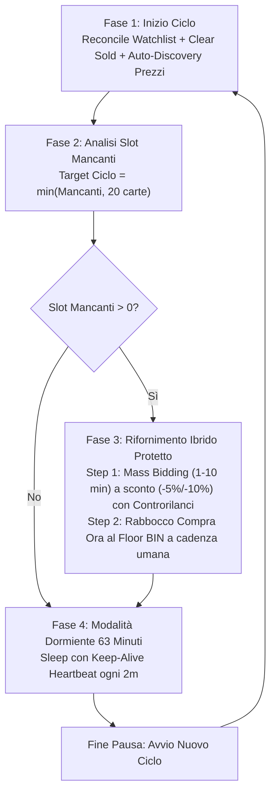

# FC Sniper & Trader - Documentazione Ufficiale

Estensione browser (Manifest V3) per l'automazione avanzata del trading sulla Web App di **EA SPORTS FC (FC27)**. Integra algoritmi di **Sniping Diretto**, **Mass Bidding** e **Lazy Trading**, supportati da un bridge di telemetria PIN nativo per massimizzare la sicurezza dell'account contro i controlli anti-cheat di EA.

---

## Indice
1. [Architettura del Sistema](#architettura-del-sistema)
2. [Strategie di Trading](#strategie-di-trading)
   - [1. Sniping Diretto (BIN)](#1-sniping-diretto-bin)
   - [2. Mass Bidding (Aste)](#2-mass-bidding-aste)
   - [3. Lazy Trading (Consumabili & Stili Intesa)](#3-lazy-trading-consumabili--stili-intesa)
3. [Funzionamento Dettagliato del Lazy Trading](#funzionamento-dettagliato-del-lazy-trading)
   - [Il Ciclo Operativo a 5 Fasi](#il-ciclo-operativo-a-5-fasi)
   - [Perché la Pausa di 63 Minuti](#perché-la-pausa-di-63-minuti)
   - [Controllo Dinamico del Lowest BIN Live](#controllo-dinamico-del-lowest-bin-live)
   - [Ricarico del +10% e Scalini Ufficiali EA](#ricarico-del-10-e-scalini-ufficiali-ea)
   - [Sistema Keep-Alive Heartbeat (Prevenzione Errore 401)](#sistema-keep-alive-heartbeat-prevenzione-errore-401)
   - [Spegnimento Notturno e Ripresa del Giorno Dopo](#spegnimento-notturno-e-ripresa-del-giorno-dopo)
4. [Sistemi Anti-Ban e Sicurezza](#sistemi-anti-ban-e-sicurezza)
5. [Configurazione da Interfaccia Utente (UI)](#configurazione-da-interfaccia-utente-ui)
6. [Guida all'Installazione e Primo Avvio](#guida-allinstallazione-e-primo-avvio)

---

## Architettura del Sistema

Il bot è strutturato secondo i più moderni standard **Chrome Extensions Manifest V3**:

* **`fc26.js` (Service Worker / Background)**:
  Contiene l'intero motore decisionale, la gestione dello stato, le chiamate HTTP asincrone verso gli endpoint UTAS di EA, i gestori di rate limiting, il calcolo dei ritardi gaussiani e il ciclo dormiente del Lazy Trading.
* **`content.js` (Content Script)**:
  Inietta `pin-bridge.js` all'interno del mondo di esecuzione principale (`MAIN` world) della pagina web ed instaura un canale bidirezionale tramite `window.postMessage` per la sincronizzazione telemetrica.
* **`pin-bridge.js` (Native World Bridge)**:
  Si aggancia al servizio nativo `window.services.PIN` o all'injector Angular della Web App di EA. Genera eventi telemetrici nativi conformi (`page_view`, click sui filtri, visualizzazione dettagli carta e navigazione transfer market), garantendo che il counter di telemetria dell'account EA (`stepCounter`) rimanga perfettamente sincronizzato con le richieste di rete.
* **`ui.js` & `index.html` (Interfaccia Grafica / Popup)**:
  Fornisce una dashboard intuitiva con selezione in tempo reale della strategia, configurazione dinamica dei parametri, visualizzazione crediti, log di debug scorrevole e salvataggio automatico dello stato su `chrome.storage.local`.

---

## Strategie di Trading

### 1. Sniping Diretto (BIN) & Risoluzione Errore 461
* **Obiettivo**: Catturare all'istante carte messe in vendita ad un prezzo significativamente inferiore al loro valore di mercato prima degli altri bot o utenti.
* **Bersagli supportati**:
  * **Fodder**: Carte oro ad alto rating (84, 85, 86, 87, 88).
  * **Consumabili**: Stili Intesa ad alta richiesta (Ombra, Cacciatore, Ancora, Motore, Catalizzatore).
  * **Manuale**: Filtro configurato direttamente dall'utente nella Web App.
* **Perché si verificava l'Errore 461 (Item Already Bought) e come è stato risolto**:
  1. **Cache-Busting Regolare (`micr` 0 / 150)**: Alterna il parametro di offerta minima `micr` esclusivamente tra **0** (nessun filtro minimo impostato) e **150** (scalino minimo base di EA). L'URL di ricerca cambia ad ogni chiamata forzando risposte fresche dai server di EA senza mai escludere le nuove carte e senza usare valori anomali di offerta massima.
  2. **Eliminazione Paginazione Fantasma (`start=0`)**: Rimossa l'errata alternanza a `start=200` (che interrogava la pagina 10 del mercato con carte vecchie e già vendute). Lo sniping interroga sempre e solo `start=0` (la prima pagina delle offerte appena immesse).
  3. **Ordinamento per Freschezza Decrescente (`expires`)**: I risultati restituiti da EA contengono talvolta carte residue/fantasma. Il bot ordina i risultati per `expires` decrescente: la carta con tempo residuo più alto (es. 3599s = listata da meno di 1 secondo) viene selezionata per prima.
  4. **Telemetria PIN Rigorosamente Preventiva (Anti Soft-Ban)**: Gli eventi PIN nativi (`Item - Detail View`, `Transfer Market Results`) vengono inviati ed attesi **prima** di inviare la richiesta di acquisto o di offerta HTTP. Questo replica con assoluta fedeltà la sequenza della Web App umana (click carta $\to$ visualizzazione dettaglio $\to$ conferma acquisto) impedendo che i server EA rilevino chiamate disallineate.
  5. **Pre-calcolo dei Target**: I prezzi di mercato e le soglie di snipe vengono calcolati una volta prima del loop, eliminando blocchi intermedi durante la sessione di ricerca.
  6. **Cadenza di Sniping Competitiva**: Intervalli di ricerca veloci (0.7s - 1.25s) con micro-pause anti-limit di 2.5s ogni 25 tentativi (senza più congelamenti di diversi minuti).

### 2. Mass Bidding (Aste)
* **Obiettivo**: Piazzare offerte massive all'asta su carte in scadenza, aggiudicandosele ad un prezzo inferiore al valore di mercato.
* **Margine Netto Dinamico**: Calcola la massima offerta consentita sottraendo la tassa EA del 5% e il margine minimo richiesto dall'utente (`maxBid = (marketPrice * 0.95) - minMargin`).
* **Auto-Reconciliation Watchlist**: Recupera e riscatta automaticamente le carte vinte da sessioni precedenti all'avvio.

### 3. Lazy Trading (Consumabili & Stili Intesa)
* **Obiettivo**: Generare profitto continuo e passivo sfruttando il comportamento dei **"Lazy Buyers"** (utenti che non cercano il prezzo più basso del mercato, ma acquistano direttamente le carte con tempo residuo 58-59 minuti o a prezzi arrotondati pur di applicare subito lo stile intesa al proprio calciatore).
* **Funzionamento generale**: Mantiene la Lista Trasferimenti (Tradepile) sempre rifornita con un numero target di carte (es. 50 carte) acquistate al prezzo floor e rimesse in vendita al **+10%**. Tra un ciclo e l'altro, il bot resta **completamente dormiente per 63 minuti**, mantenendo la sessione attiva con un **heartbeat periodico**.

---

## Funzionamento Dettagliato del Lazy Trading

#### Il Ciclo Operativo Ibrido Protetto (Mass Bidding + Rabbocco Compra Ora al Floor BIN)

Il Lazy Trading opera secondo un'architettura **Ibrida Protetta a due fasi di rifornimento**, progettata per garantire l'autosufficienza della Tradepile (riempimento costante dei posti vuoti) azzerando il rischio di soft-ban grazie al controllo della frequenza e a cap rigorosi:



1. **Fase 1 - Pulizia, Incasso Vendite, Riconciliazione & Recupero Inizio Ciclo**:
   * Esegue `reconcileWatchlistOnStartup()` per ritirare e mettere in vendita qualsiasi asta vinta in precedenza.
   * **Auto-Discovery Prezzi di Ciclo**: rileva il Floor BIN live dello stile selezionato e fissa i prezzi di acquisto e vendita (+10%) per l'intero ciclo.
   * Esegue `clearSoldItem(cyclePrices)`: rimuove le vendute, incassa i crediti e **rilista ogni carta scaduta ricalcolando il prezzo al Lowest BIN live + 10%** (invece di riciclare ciecamente vecchi prezzi gonfiati o errati!).
   * **Controllo Inizio Ciclo Carte Non Listate (`listUnlistedTradepileItems`)**: scansiona la Tradepile e mette immediatamente in vendita qualsiasi carta acquistata non ancora attiva al prezzo ricalcolato!
2. **Fase 2 - Analisi Capienza Attiva & Scaglionamento (Cap 20 Carte/Ciclo)**:
   * Interroga `GET /tradepile` calcolando il numero di carte **effettivamente attive in vendita sul mercato** (`pileInfo.active`), non limitandosi al totale grezzo.
   * Calcola il fabbisogno grezzo:
     $$\text{rawMissing} = \max(0, \text{targetTradepileSize} - \text{activeListings})$$
   * **Cap Prudenziale Anti-Ban**: Per evitare di superare la velocità oraria di transazioni imposta dai server EA quando la lista ha molti slot vuoti (es. 75), il bot rifornisce un massimo di **20 carte per ciclo**:
     $$\text{cycleTarget} = \min(\text{rawMissing}, 20)$$
     In questo modo, anche partendo da lista completamente vuota, la Tradepile viene riempita stabilmente e in totale sicurezza nel corso di cicli successivi senza mai far scattare rate-limit.
3. **Fase 3 - Rifornimento Ibrido Protetto**:
   * **Step 1: Mass Bidding con Risoluzione Attiva e Controrilanci**:
     - **Finestra Temporale Estesa (1–10 Minuti)**: Cerca carte in scadenza entro i 10 minuti (`expires <= 600s`) con `macr = maxBidAllowed`. In questo modo include sia carte con offerte in corso che carte senza alcuna offerta ma con `startingBid <= maxBidAllowed`. Il controllo locale `nextBid <= maxBidAllowed` seleziona poi tutte le aste idonee.
     - **Controrilanci Difensivi**: Se un altro utente supera la nostra offerta (`bidState === "outbid"`), il bot controrilancia istantaneamente se `nextBid <= maxBidAllowed`. Se l'asta supera la soglia, la rimuove per liberare spazio.
     - **Cap Concorrenza Watchlist (Max 35 Offerte Attive)**: Se le offerte contemporanee raggiungono quota 35, attende la loro conclusione prima di cercare altre aste.
   * **Step 2: Rabbocco Compra Ora al Floor BIN (Completamento Garantito)**:
     - Se al termine del Mass Bidding rimangono slot vuoti per completare il `cycleTarget`, il bot acquista le carte mancanti direttamente a **Compra Ora al Floor BIN**.
     - **Cadenza Umana Protetta (2.2s - 3.0s)**: Non esegue sniping aggressivo su carte sotto-costo (fonte di errori 461), ma compra al floor effettivo di mercato dove le carte sono disponibili senza contesa.
     - **Interruzione Istantanea su Rate Limit**: Al primo segnale di errore 512, 429 o 426 su Compra Ora, arresta subito la fase di acquisto ed entra in attesa vendite.
4. **Circuito di Sicurezza Anti-Softban (Stop a 3 Errori Consecutivi)**:
   * Se durante il ciclo si verificano **3 errori consecutivi da EA**, il bot interrompe immediatamente gli acquisti ed entra in modalità dormiente di 63 minuti.
5. **Fase 4 - Pausa Dormiente (63 Minuti) con Keep-Alive Heartbeat ogni 2 Minuti**:
   * Il bot entra a riposo per 63 minuti.
   * Ogni 2 minuti invia l'heartbeat telemetrico PIN e recupero crediti per proteggere la sessione da disconnessioni (`401`).

---

### Perché la Pausa di 63 Minuti

Le aste standard su EA SPORTS FC hanno una durata di **60 minuti (1 ora)**.
Impostare il timer di sonno a **63 minuti** è un pilastro fondamentale della strategia:
1. **Conclusione Certa delle Aste**: Al 63° minuto, il 100% delle carte listate nel ciclo precedente ha terminato il proprio ciclo d'asta (sono state acquistate oppure sono scadute).
2. **Quadro Pulito della Lista Trasferimenti**: Non esistono carte a metà asta o con tempi incerti: la Tradepile si trova in uno stato nitido e consolidato.
3. **Minimo Traffico di Rete**: Durante l'intera ora, il bot non esegue polling o ricerche invasive, azzerando quasi totalmente il rischio di rate-limiting o controlli di sicurezza EA.

---

### Controllo Dinamico del Lowest BIN & Re-Discovery Live

Il bot rileva i prezzi di mercato in modo efficiente e resiliente:

1. **Auto-Discovery Iniziale con Scrematura Progressiva**:
   * All'inizio di ciascun ciclo, scansiona il mercato cercando la fascia in cui le carte hanno un tempo rimanente di **58-59 minuti** (ovvero carte listate da meno di 90 secondi).
   * Identifica il punto in cui il mercato è privo di carte "stagnanti" e determina il Floor BIN reale per lo stile selezionato (es. *Ombra* 4.400 crediti).
   * Fissa i parametri per il ciclo:
     $\text{maxBidAllowed} = \text{roundDownToStep}(\text{liveFloorBin} \times 0.95) \quad (-5\%)$
     $\text{sellPrice} = \text{roundUpToStep}(\text{liveFloorBin} \times 1.10) \quad (+10\%)$
2. **Re-Discovery Dinamico Live (Se il Mercato Sale)**:
   * Se il mercato sale durante il ciclo e 10 ricerche consecutive per un determinato stile restituiscono 0 carte valide, il bot attiva immediatamente la riscrematura in tempo reale di quello stile (`discoverConsumableLowestBin`), aggiornando il Floor BIN e il prezzo di vendita (+10%) per riprendere subito ad offrire al nuovo prezzo di mercato.
3. **Cache Anti-Carte Fantasma (`attemptedTradeIds` - 5 Minuti)**:
   * Memorizza gli ID delle carte per le quali è già stata tentata un'offerta andata persa o fallita per evitare di ritentare all'infinito carte rimaste in cache sui server EA.
   * I record scadono automaticamente dopo **5 minuti**, garantendo una sincronizzazione ottimale con i server EA senza consumare memoria.

---

### Ricarico del +10% e Scalini Ufficiali EA

Nel Lazy Trading, le carte acquistate al floor di mercato vengono immediatamente listate con un sovrapprezzo del **+10%** (o la percentuale personalizzata dall'utente) rispetto al Lowest BIN live rilevato:

$$\text{prezzoGrezzo} = \text{liveFloorBin} \times \left(1 + \frac{\text{markupPercent}}{100}\right)$$

Poiché EA accetta sul mercato solo prezzi allineati a scalini discreti (step di 50 o 100 crediti), il bot implementa la funzione `roundUpToStep(prezzo)`:

```javascript
function getEaStep(price) {
  if (price >= 100000) return 1000;
  if (price >= 50000) return 500;
  if (price >= 10000) return 250;
  if (price >= 1000) return 100;
  return 50;
}

function roundUpToStep(price) {
  const step = getEaStep(price);
  return Math.ceil(price / step) * step;
}
```

#### Esempio di Profitto Reale (Acquisto -5%, Vendita +10%):
* Prezzo Floor rilevato (*Ombra*): **4.400 crediti**
* **Acquisto al -5%** (`roundDownToStep(4.400 * 0.95)`): **4.100 crediti**
* **Vendita al +10%** (`roundUpToStep(4.400 * 1.10)`): **4.900 crediti**
* Vendita lorda: **4.900 crediti**
* Tassa EA (5%): **245 crediti**
* Ricavo netto: $4.900 - 245 = \mathbf{4.655\text{ crediti}}$
* **Profitto netto per singola carta**: $4.655 - 4.100 = \mathbf{+555\text{ crediti}}$
* **Profitto su 50 carte vendute**: $\sim \mathbf{27.750\text{ crediti netti a ciclo!}}$

---

### Sistema Keep-Alive Port (Manifest V3) & Heartbeat Anti-Scadenza EA

Se un'estensione Manifest V3 rimane inattiva per più di **30 secondi**, Chrome termina forzatamente il Service Worker in background (`fc26.js`). Inoltre, se i server UTAS di EA non ricevono richieste per più di **15-20 minuti**, invalidano il token di autenticazione (`x-ut-sid`), causando la disconnessione della Web App (`Errore 401`).

Il bot adotta una protezione a doppio strato che risolve entrambi i problemi:
1. **Canale Port Keep-Alive Permanente (Chrome MV3)**:
   * Sia `content.js` (nella scheda della Web App) sia `ui.js` (nella scheda della dashboard) instaurano una connessione `chrome.runtime.connect({ name: "KEEP_ALIVE_PORT" })`.
   * Un ping ogni **20 secondi** azzera continuativamente il timer di inattività di Chrome, garantendo che il Service Worker non venga **mai addormentato o terminato dal browser**, anche durante ore di pausa o cicli notturni.
   * Viene inoltre registrato un allarme di riserva periodico con `chrome.alarms` per la massima ridondanza.
2. **Heartbeat Attivo EA ogni 2 Minuti (Anti-Disconnessione Web App)**:
   * Sia durante il sonno di **63 minuti** del Lazy Trading sia durante la **pausa di sicurezza di 10 minuti** per soft-ban:
     1. Il ciclo esegue un micro-ping leggero ogni **120 secondi** (`TRIGGER_PIN_WATCHLIST` + `getCrediti()`).
     2. Questo valida costantemente il token `x-ut-sid` sui server EA: la sessione della Web App **non scade mai**.
     3. I log della dashboard mostrano un conto alla rovescia minuto per minuto:
        `[PAUSA DI SICUREZZA] Sblocco soft-ban in corso... Mancano 7 min alla ripresa automatica.`
        `[LAZY HEARTBEAT] Sessione EA attiva! Crediti: 245.300. Prossimo ciclo tra 48 min.`
3. **Gestione Intelligente e Salvaguardia Account (Stop a 3 Errori Consecutivi)**:
   * Nel Lazy Trading basato su 100% Mass Bidding, le chiamate a Compra Ora sono azzerate. Qualora tuttavia si verificassero **3 errori consecutivi da EA** (es. codici 512, 429, timeout o disconnessioni temporanee), il bot arresta all'istante i tentativi ed entra direttamente nella fase dormiente di 63 minuti con Keep-Alive. In questo modo il contatore di EA si azzera naturalmente durante la pausa mentre le carte già listate continuano a vendere e generare profitti, senza rischiare escalation di blocchi.

---

### Spegnimento Notturno e Ripresa del Giorno Dopo

Una delle caratteristiche più potenti dell'architettura del bot è la sua **natura stateless e server-aligned**:

> **Cosa succede se spegni il PC la notte?**
>
> 1. Quando spegni il PC o chiudi il browser, le carte rimangono attive sui server di EA fino alla scadenza naturale delle aste.
> 2. Durante la notte, i giocatori continuano a comprare le tue carte al prezzo maggiorato (+10%).
> 3. Al mattino, quando riaccendi il PC, apri la Web App e clicchi su **Start**:
>    * Il bot avvia la **Fase 1 (`clearSoldItem`)**: riscuote istantaneamente tutti i crediti accumulati dalle carte vendute nella notte e rilista quelle eventualmente rimaste invendute.
>    * Il bot esegue la **Fase 2**: rileva quanti slot si sono liberati.
>    * Il bot esegue la **Fase 3**: controlla il BIN live del giorno e compra solo le carte mancanti (fino a 20 per ciclo) per tornare al target (es. 50 carte).
>    * Il bot si rimette a dormire per 63 minuti.
>
> **Nessun dato o stato viene perso: la ripresa è immediata e trasparente al 100%.**

---

## Sistemi Anti-Ban e Sicurezza

Il bot adotta molteplici livelli di sicurezza contro i sistemi euristici di rilevamento di EA:

1. **Bridge PIN Telemetry Nativo**:
   * Tutte le operazioni chiave (ricerca, visualizzazione dettaglio carta, piazzamento offerta, acquisto compra ora, listaggio vendita) generano i PIN events nativi di EA tramite `pin-bridge.js`.
2. **Ritardi Gaussiani (Box-Muller)**:
   * Nessun intervallo temporale è fisso. Tutte le pause (`sleep`) sono calcolate tramite distribuzione gaussiana casuale, simulando perfettamente le micro-variazioni nei tempi di reazione di un essere umano.
3. **Gestione Rate-Limiting Avanzata**:
   * Rilevamento dei codici di limitazione EA (`429`, `426`, `512`, `521`).
   * Cooldown progressivi con backoff esponenziale. Se si verificano 3 errori consecutivi da EA durante il rifornimento, il bot attiva la transizione protettiva alla modalità dormiente di 63 minuti.
4. **Rilevamento CAPTCHA FunCaptcha (458)**:
   * Al primo segnale di verifica utente richiesta da EA (`HTTP 458`), il bot arresta immediatamente qualsiasi operazione, emette un avviso sonoro/visivo nel log e non invia ulteriori richieste finché l'utente non completa la verifica manualmente.
5. **Protezione Crediti Insufficienti**:
   * Se il saldo scende al di sotto del prezzo di acquisto di una carta, il bot interrompe il rifornimento ed entra direttamente in pausa dormiente in attesa delle vendite del ciclo successivo.

---

## Configurazione da Interfaccia Utente (UI)

| Parametro | Descrizione | Valore Consigliato |
| :--- | :--- | :--- |
| **Tentativi ricerca** | Limite ricerche per Sniping diretto (nel Lazy Trading il ciclo è continuo fino a stop). | 50 - 200 |
| **Obiettivo** | Seleziona il tipo di articolo (`Consumabili`, `Fodder`, `Manuale`). | Consumabili |
| **Strategia** | Seleziona tra `Sniping`, `Bidding` e `Lazy`. | Lazy |
| **Stile Intesa** | Stile intesa bersaglio (`Ombra`, `Cacciatore`, o `Rotazione`). | Ombra (Shadow) |
| **Target Carte in Vendita** | Numero desiderato di carte mantenute costantemente nella Tradepile. | 50 (o 80 con lista estesa) |
| **Ricarico Vendita (%)** | Percentuale di sovrapprezzo rispetto al Lowest BIN live. | 10% |
| **Pausa Ciclo (minuti)** | Tempo di attesa tra un ciclo di vendita e il successivo. | 63 minuti |

### Dashboard & Terminale Log Interattivo
L'interfaccia include:
* **Barra di Stato Live**: mostra in tempo reale l'attività in corso (`Pronto`, `In esecuzione`, `In pausa / Dormiente`, `Acquisto riuscito`) con badge di notifica.
* **Metriche di Trading in Evidenza**: riquadro dedicato con saldo crediti formattato, conteggio carte acquistate/vinte e tentativi residui.
* **Console Terminale Dark**: righe di log colorate per categoria (Verde = Acquisto/Vendita, Viola = Offerta, Giallo = Pausa, Rosso = Avviso/461, Blu = Stato).
* **Filtri Rapidi a Pulsante**:
  * `Tutti`: visualizza l'intera cronologia degli eventi.
  * `Acquisti & Vendite`: filtra esclusivamente le transazioni e i guadagni.
  * `Stato & Pause`: isola le transizioni di ciclo e il countdown della modalità dormiente.
  * `Avvisi`: evidenzia soft-ban, 461 o captcha.
* **Pulsante Pulisci**: azzera la console per avviare una nuova sessione pulita.

---

## Guida all'Installazione e Primo Avvio

1. **Apri Google Chrome** e digita nella barra degli indirizzi:
   `chrome://extensions/`
2. Abilita la **"Modalità sviluppatore"** in alto a destra.
3. Clicca su **"Carica estensione non pacchettizzata"** e seleziona la cartella del progetto:
   `c:\Programmazione\Javascript\fcsniper`
4. Apri la **Web App di EA SPORTS FC**:
   `https://www.ea.com/ea-sports-fc/ultimate-team/web-app/`
5. Effettua il login al tuo account Ultimate Team.
6. Clicca sull'icona dell'estensione **FC Sniper** nella barra degli strumenti di Chrome:
   * Seleziona Strategia: **Lazy**
   * Imposta lo Stile Intesa: **Ombra** oppure **Tutti (Ombra + Cacciatore)**
   * Imposta il Target Carte: **50**
   * Clicca su **Start**.
7. Lascia la scheda della Web App aperta: il bot gestirà in totale autonomia acquisti, vendite, riscossioni e pause.
