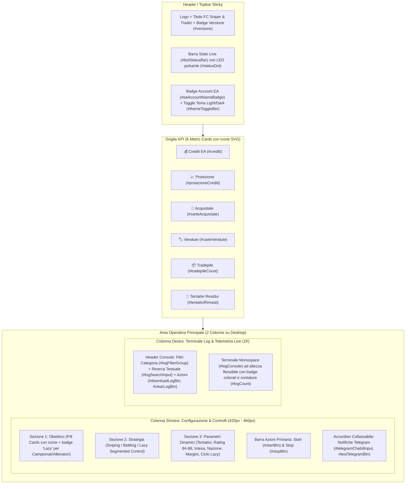

# Piano di Refactor UI — FC Sniper & Trader

## Obiettivo
Trasformare l'interfaccia utente di **FC Sniper & Trader** (attualmente strutturata come un vecchio popup Bootstrap adattato a scheda) in una **Trading Dashboard moderna, fresca, accattivante e intuitiva** basata su un layout **Bento Grid a tutta pagina** e un sistema **Dual Theme (Dark / Light)**, **senza alterare in alcun modo la logica di funzionamento del bot**, i payload IPC o le chiavi di `chrome.storage.local`.

> [!IMPORTANT]
> **Invarianza Funzionale Garantita**: Tutti gli ID del DOM, i `name` e `value` dei radio/input, i messaggi `chrome.runtime` (`START`, `LOG`, `CREDITI`, `PROIEZIONE_CREDITI`, `CARTA_ACQUISTATA`, `CARTA_VENDUTA`, `TRADEPILE_COUNT`, `TENTATIVI_RIMASTI`, `USER_SYNC`, `TELEGRAM_TEST`) e la logica di `fc26.js` e `src/strategies/*` rimarranno **100% invariati**.

---

## Architettura del Nuovo Layout (Bento Grid)



---

## Modifiche Proposte per Componente

### 1. Design System & Dual Theme (`ui.css`)

#### [MODIFY] `ui.css`
Sostituzione degli stili legacy pseudo-Bootstrap con un **Design System basato su CSS Custom Properties** (`:root` per il tema **Dark "EA FC Pro"** predefinito e `[data-theme="light"]` per il tema **Light "Fintech Minimal"**), mantenendo tutte le classi di utilità usate da JavaScript (`.d-none`, `.show`, `.active`, `.text-success`, `.text-warning`, `.text-danger`, `.text-info`, `.text-primary`, `.text-secondary`).

- **Palette Tema Dark (`[data-theme="dark"]` - Default)**:
  - Background primario: `#0b0f17` (nero ardesia profondo con leggero gradiente radiale emerald/cyan in alto)
  - Superfici Card (`.bento-card`): `#131b2e` / `rgba(22, 31, 51, 0.85)` con `backdrop-filter: blur(12px)` e bordo sottile `1px solid rgba(255, 255, 255, 0.08)`
  - Accento primario (EA FC Neon Emerald): `#10b981` (hover `#059669`, glow `rgba(16, 185, 129, 0.25)`)
  - Accento secondario (Electric Blue): `#3b82f6`
- **Palette Tema Light (`[data-theme="light"]`)**:
  - Background primario: `#f1f5f9` con gradiente morbido superiore
  - Superfici Card: `#ffffff` con bordo `#e2e8f0` e ombra morbida `0 4px 20px -2px rgba(15, 23, 42, 0.05)`
  - Accento primario: `#059669` / `#2563eb`
- **Componenti UI Moderni**:
  - **KPI Bento Cards**: layout in griglia responsiva `grid-template-columns: repeat(6, minmax(0, 1fr))` (che scala a 3x2 su schermi medi e 2x3 su schermi piccoli), con icona vettoriale dedicata, label secondaria uppercase e valore numerico in font monospace ad alto contrasto.
  - **Target & Strategy Cards / Segmented Controls**: i radio button `btn-check` + `label` vengono trasformati in tessere interattive con icona SVG, stato attivo evidenziato con bordo luminoso/sfondo accentato e micro-transizione fluida.
  - **Status Dot Pulsante (`#statusDot`)**: trasformato in un indicatore LED circolare con animazione `@keyframes pulse-ring` automatica quando ha classe `.text-success`, `.text-info` o `.text-primary` (bot attivo).
  - **Terminale Log Flessibile**: occupa tutta l'altezza disponibile della colonna destra (`min-height: 480px; height: calc(100vh - 250px)` su desktop), mantenendo sempre un look scuro ad alto contrasto per la massima leggibilità dei tag.

---

### 2. Struttura HTML Bento Grid (`index.html`)

#### [MODIFY] `index.html`
Riorganizzazione semantica del markup eliminando gli `style="width: 200px;"` inline e raggruppando i controlli in sezioni logiche chiare:

1. **Topbar Header**:
   - Brand con icona SVG scudo/fulmine + titolo **FC Sniper & Trader** + badge `#versione` (`v2.7.5`).
   - **Status Pill Centrale (`#botStatusBar`)**: include `#statusDot`, `#statusText` e `#statusSubtext` in una capsula ben visibile al centro della topbar.
   - **Area Profilo & Tema**: badge account Web App (`#eaAccountNameBadge`) con icona utente e pulsante switch tema `#themeToggleBtn` (Sole/Luna).
2. **Griglia KPI Superiore**:
   - 6 card affiancate per `#crediti`, `#proiezioneCrediti`, `#carteAcquistate`, `#carteVendute`, `#tradepileCount`, `#tentativiRimasti`.
3. **Pannello Sinistro — Configurazione & Avvio**:
   - **Passo 1 — Obiettivo (`targetMode`)**: griglia di 5 tessere cliccabili (`Fodder`, `Consumabili`, `Campionati`, `Allenatori`, `Manuale`) con icone SVG e mini-badge `LAZY` su Campionati e Allenatori per rendere subito chiaro il comportamento.
   - **Passo 2 — Strategia (`strategyMode`)**: Segmented Control a 3 opzioni (`⚡ Sniping`, `🔨 Bidding`, `🌙 Lazy`).
   - **Passo 3 — Parametri Operativi**:
     - Input `#tentativi` a larghezza piena con icona e testo guida.
     - Contenitori contestuali (`#fodderRatingContainer`, `#consumablesConfigContainer`, `#managersConfigContainer`, `#manualConfigContainer`, `#biddingConfigContainer`, `#lazyConfigContainer`) impaginati in griglie pulite a 1 o 2 colonne senza larghezze fisse a `200px`.
   - **Barra Azioni (`#startBtn`, `#stopBtn`)**: pulsanti grandi con icone Play/Stop, effetto gradiente ed elevazione quando attivi.
   - **Pannello Notifiche Telegram Collassabile**: sezione a fisarmonica (compatibile con `[data-bs-toggle="collapse"]`) che racchiude `#telegramChatIdInput`, `#testTelegramBtn` e `#telegramTestFeedback` senza appesantire la schermata principale.
4. **Pannello Destro — Console Eventi Live**:
   - Sempre visibile su desktop (e collassabile su mobile tramite pulsante), con filtri rapidi `#logFilterGroup`, nuovo campo di ricerca istantanea `#logSearchInput`, contatore `#logCount`, pulsanti `#downloadLogBtn` e `#clearLogBtn`, e area `#logConsole`.

---

### 3. Miglioramenti UX nei Moduli UI (`src/ui/form-controls.js` e `src/ui/log-console.js`)

#### [MODIFY] `src/ui/form-controls.js`
- Aggiunta della gestione del tema (`uiTheme`: `'dark'` | `'light'`) salvato in `chrome.storage.local` e applicato su `document.documentElement.setAttribute('data-theme', theme)`.
- Quando il pannello Telegram ha già un Chat ID configurato, mostra un piccolo badge "Configurato" nell'intestazione dell'accordion Telegram.

```javascript
// Gestione Tema Dark / Light persistente
export function initThemeToggle() {
  const themeBtn = document.getElementById('themeToggleBtn');
  const applyTheme = (theme) => {
    const resolved = theme === 'light' ? 'light' : 'dark';
    document.documentElement.setAttribute('data-theme', resolved);
    if (themeBtn) {
      themeBtn.setAttribute('aria-label', resolved === 'dark' ? 'Passa al tema chiaro' : 'Passa al tema scuro');
      themeBtn.dataset.currentTheme = resolved;
    }
  };
  chrome.storage.local.get(['uiTheme'], (res) => {
    applyTheme(res.uiTheme || 'dark');
  });
  themeBtn?.addEventListener('click', () => {
    const current = document.documentElement.getAttribute('data-theme') === 'light' ? 'light' : 'dark';
    const next = current === 'dark' ? 'light' : 'dark';
    applyTheme(next);
    chrome.storage.local.set({ uiTheme: next });
  });
}
```

#### [MODIFY] `src/ui/log-console.js`
- Aggiunta del filtro di ricerca testuale opzionale (`#logSearchInput`) combinato con i filtri categoria esistenti (`all`, `trade`, `sleep`, `warn`) in `applyLogFilter()` e `logToScreen()`, così l'utente può cercare rapidamente il nome di un giocatore, un prezzo o un codice errore (`461`, `429`) nel terminale senza toccare il buffer `allLogRecords`.

---

## Piano di Verifica

### 1. Verifica Integrità DOM e Sintassi JS
- Controllo sintattico dei moduli ES (`node --check ui.js`, `node --check src/ui/form-controls.js`, `node --check src/ui/log-console.js`).
- Verifica automatica che tutti i 35+ ID del DOM referenziati da `ui.js`, `form-controls.js` e `log-console.js` siano presenti in `index.html`.

### 2. Verifica Visiva e Interattiva nel Browser
- Apertura e ispezione di `index.html` per verificare:
  - Switch tra **Dark Mode** e **Light Mode** e persistenza.
  - Selezione di ciascuno dei 5 **Obiettivi** (`Fodder`, `Consumabili`, `Campionati`, `Allenatori`, `Manuale`) e delle 3 **Strategie** (`Sniping`, `Bidding`, `Lazy`), verificando la comparsa/scomparsa dei relativi pannelli di configurazione e lo switch automatico a `Lazy` per Campionati/Allenatori.
  - Simulazione di righe di log di ogni categoria (`ACQUISTO`, `OFFERTA`, `ASTA SUPERATA`, `PAUSA`, `AVVISO`, `STATO`), filtro per categoria, ricerca testuale e download del file `.txt`.
  - Stato disabilitato dei controlli quando il bot è in esecuzione (`setRunningUiState(true)`).
